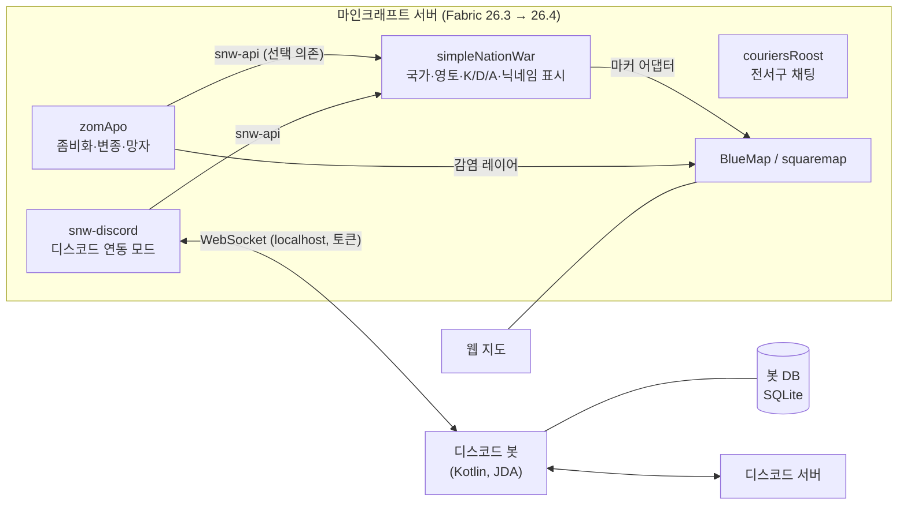

# 서버 기획서

두 모드(zomApo, simpleNationWar)와 디스코드 봇을 아우르는 최상위 기획. 결정의 상세 근거는 [decisions.md](decisions.md), 수치 근거는 [simulation.md](simulation.md)·[performance.md](performance.md), 개인정보는 [privacy.md](privacy.md).

## 목차

1. [개요](#개요)
2. [일정](#일정)
3. [버전 정책](#버전-정책)
4. [모드 목록](#모드-목록)
5. [요구사항 대조](#요구사항-대조)

---

## 개요

좀비 아포칼립스 야생 + 3국 집단 생존 서버. 이 문서는 두 모드(zomApo, simpleNationWar)와 디스코드 봇을 아우르는 최상위 기획이다.

### 1. 전제

| 항목 | 값 |
|---|---|
| 전체 인원 | 최대 20±3명 (친구 서버, 화이트리스트). 2026-11-20 상향, 이전 가정 10~15명 |
| 활성 인구 | 8~10+α명 (하루 2시간 이상 접속). 이전 가정 3~4명 |
| 국가 | 3개 고정. 랜덤 또는 합의로 균등 배분 |
| 동시 접속 | 보통 3~4명, 붐빌 때 7~8명, 행사 때 15명 이상 가능 ([performance.md](performance.md) 3절) |
| 서버 PC | Ryzen 5 9600X · DDR5 32GB · Windows 11. 운영자가 같은 PC 에서 플레이 |
| 난이도 | 어려움(Hard) |
| 버전 | 26.3 에서 개발·테스트, 26.4 정식 출시 즉시 26.4 로 전환 |
| 운영 기간 | 2027-01-16(토) ~ 2027-02-07(일), 23일 (시즌 1). 겨울방학 중, 끝 무렵 설 연휴(2/5~2/8) |
| 모드 | Fabric, Kotlin, 서버 사이드 전용 (Folia 전환 검토 후 유지, [performance.md](performance.md)) |
| 커뮤니티 | 디스코드. 팀 확정 후 국가별 채널 분리 |

> 인원 가정을 올렸다(10~15명/활성 3~4명 → 최대 20±3명/활성 8~10+α명). 서버 사양([performance.md](performance.md))과 플레이 양상·좀비화 보정·블러드문·치료제 수치([simulation.md](simulation.md))를 모두 새 가정으로 다시 계산했다. 결정별 판정은 [decisions.md](decisions.md) 12절.

### 2. 설계 원칙

0. **시간 단위.** 문서의 일·주·시간·분은 모두 **현실 시간**이다. 게임 시간은 '게임 일'로 따로 쓴다(게임 1일 = 현실 20분). 서버가 비면 틱이 멈추는 기본 설정(`pause-when-empty-seconds`)을 유지하므로 게임 시간은 누군가 접속해 있을 때만 흐른다([bloodmoon-and-cure.md](../design/bloodmoon-and-cure.md) 0절).

1. **바닐라 클라이언트로 접속한다.** 직접 만드는 모드는 모두 `environment: "server"`. 모드 설치는 없고, **서버 리소스팩은 필수**다(접속할 때 자동으로 받음, 1MB 안팎으로 가볍게. 2026-11-21 개정). 새 블록·엔티티 대신 바닐라 엔티티 + 데이터 부착 + 리소스팩 외형, 바닐라 아이템 + 컴포넌트, 상자 GUI·다이얼로그·액션바로 표현한다.
2. **한 명만 접속해도 재미있어야 한다.** 시뮬레이션상 20명/활성 10명에서도 플레이 시간의 36%(17/8~23/12: 31~44%)는 같은 국가 사람이 아무도 없을 때다([simulation.md](simulation.md) 2절). 이전 가정(63~78%)보다 크게 줄어 국가 안 협동이 주된 경험이 되지만, 3분의 1은 여전히 국민 없이 논다. 그래서 비동기 협동(국고, 국가 프로젝트, 전서구 편지)과 국가 간 상호작용(교역, 동맹, 공동 이벤트)을 함께 설계한다.
3. **국가는 협력 단위, 전쟁은 양념.** 국가 모드는 집단 형성이 목적이다. 오프라인 약탈은 불가능하고, 충돌은 예약된 시간의 거점전과 야생 조우로만 일어난다.
4. **명령어는 적게.** 일반 플레이어가 외울 명령어는 `/n`(국가 GUI), `/info`, `/g`(전체 채팅) 세 개. 그냥 치는 채팅은 국가 채팅이다. 나머지는 블록 상호작용과 GUI 로 한다.
5. **기록은 남긴다.** K/D/A, 좀비 처치 수, 좀비 스코어, 감염 레벨 이력을 모두 저장한다. 당장 쓸 곳이 없어도 시즌 결산과 다음 시즌 밸런스에 쓴다.

### 3. 결정 요약

질문별 상세 근거는 [decisions.md](decisions.md).

| 주제 | 결정 | 한 줄 이유 |
|---|---|---|
| 주민 거래소(주민작) | **제한적 허용**: 국가당 주민 상한, 영토 안 주민 번식 불가(구출로만 확보) | 아포칼립스에서 주민은 귀한 생존자. 거래 자체는 막지 않는다 |
| 초기 정착지 | **반랜덤 공정 배치**: (0,0) 에서 1,000~3,000 고리 안 세 지점을 시드 채점으로 고르고 국가에 무작위 배정. `/snw season start` 로 모두 자기 국가 지점으로 이동, 개인 스폰은 국가 지점에서 40~60블록 땅 위 | 완전 랜덤은 지형 격차, 자유 선택은 초반 쏠림 |
| 서버맵 공개 | **지형·영토 공개, 실시간 위치·지하 비공개**, 링크는 디스코드 멤버에게만 | 정보는 외교의 재료지만 위치 추적은 사냥 도구 |
| 목표 | **'겪는 구조'**: 정해진 끝(2/7)이 있는 시계 + 찾아오는 이벤트 + 생존일지·생존 도감·칭호 + 보여 주기만 하는 경쟁 + 백신 조각 엔딩 분기 | 목적의식·시간 맞추기에 기대지 않는다. 물질 보상은 참여를 크게 늘리지 못했다 |
| 인벤세이브 | **끔 + 망자 좀비**: **좀비에게 죽으면** 소지품을 든 망자가 남고 주인만 쓰러뜨릴 수 있다. PvP 는 바닐라 드랍, 그 밖의 사고사는 15분 보존 드랍 | 좀비 아포칼립스다운 죽음에만 망자. PvP 약탈은 전투의 보상 |
| InfraCraft | **시즌 1 미채택** | 클라이언트 필수, Create Fly 의존, 26.2 전용 |
| couriersRoost | **채택**(26.4 포팅 후) | 서버 사이드 전용, '통신 두절' 테마와 맞음 |
| biomesmod | **미채택** | 새 블록 84종(클라이언트 필수), TerraBlender 필요, 26.3 미지원 |
| 월드젠 | **바닐라 생성 + 시드 탐색 도구**로 공정한 출발지 3곳 고르기. canvasworldgen 은 시즌 1 에서 뺀다 | canvasworldgen 은 개발이 멈춘 상태라 개장 일정의 위험 요소. 실제 26.4 바이옴 생성기로 시드를 수천 개 채점하면 충분하다 |
| 가방 모드 | **미채택**, 바닐라 번들·셜커 상자로 대체 | 인벤토리 압박은 생존 긴장의 일부, 의존성 위험 |
| Enchanting Infuser | **미채택** | 클라이언트·서버 양쪽 설치 필수, 26.3 빌드 미확인 |
| 커스텀 인첸트 | **채택**: 데이터팩 6종, 효과는 모드가 처리 | 바닐라 클라이언트에서 이름·툴팁이 그대로 보인다 |
| 스타포스 | **시즌 1 제외**(설정으로 꺼 둠, 설계·코드는 보존) | 이미 시스템이 많은데 새 GUI·자원 관리·숫자 공부가 한꺼번에 붙는 부담. 밸런스상 없어도 됨 ([decisions.md](decisions.md) 8-8) |
| 좀비화 진척도 | **국가 영토·접경 레벨 = 그 국가 국민의 좀비 스코어 기반**: 전역 시간 램프 + 국가 열기(최근 72시간 기본 좀비 스코어, 활동 국민 1인당, 로그) − 정화. k = 1.75. 개인 숙련도 보정은 폐지 | 스코어의 레벨 배율을 빼서 '레벨↑ → 점수↑ → 레벨↑' 가속을 막음(2/7 최고 국가 4.46 → 4.33). 누적 방식은 3주 안에 상한 도달 |
| 블러드문 | **(제안) 두 단계**: 보름달 밤(게임 시간, 8 게임일마다, 소규모) + 블러드문(현실 시간, **5명 이상·3개국 모두** 접속 시 발동, 48시간 간격, 72시간 무발동 시 강제, 대규모) | 토 21시 고정이면 3주 동안 한 번이라도 겪는 사람이 43~45%, 트리거면 78~80%. 이전 조건(3명·2개국)은 20명대에서 쿨다운이 끝나자마자 터지는 타이머가 돼서 올렸다 |
| 몹 변환 범위 | 몬스터 분류 중 **적대·중립 전부**(보스·워든 제외). 늑대 등 몬스터가 아닌 중립 몹은 제외 | 요구 사항 |
| 월드 크기 | 월드보더 **8,000 × 8,000**(반경 4,000), 수도는 반경 1,200(수도 사이 약 2,080블록) | 20명대 인원에 맞춰 넓히되, 수도끼리는 블러드문 예고 안에 오갈 거리로 |
| 서버 플랫폼 | **Fabric 유지 + 최적화 모드 7종**, Folia 미채택 | 이 인원에서 Fabric + 최적화 모드로 틱 예산 안에 든다. Folia 는 16코어 권장·스코어보드 API 미지원·모드 전부 재작성 ([performance.md](performance.md)) |
| 몹 좀비화 | **레벨별 계열 해금**(Lv1 스켈레톤·거미 → Lv2 크리퍼·엔더맨·크리킹·슬라임 → Lv3 우민·가디언·브리즈·셜커·네더), 원종 유지 + 좀비 특성·외형 + 원종/좀비 루트 각각, 구조물 출신은 바닐라 | 원종 기믹을 살리면서 레벨마다 세계가 바뀌는 체감 ([zombies.md](../design/zombies.md#몹-좀비화)) |
| 좀비 규칙 | 밤 스폰 ×(1.5+0.1L), 실내는 블록 밝기 1~4 에서도 1/4 로 스폰, Lv2+ 낮 스폰(밤의 0.1배)·무연소·좀비 떼(접속 3명 이상일 때), 낮에는 태양광 알레르기 상태 효과(Lv0 4단계 → Lv4 없음), Lv4+ 체력 ×1.5. 네더는 탐험 비율 + 근처 플레이어 좀비 스코어 | 낮은 나가서 일하고 밤은 버티는 리듬 ([zombies.md](../design/zombies.md#감염-레벨) 2·4절) |
| 겉날개 | **전면 허용** (바닐라 그대로) | 폭죽 금지·속도 절반은 반발이 더 크다. 부하는 사전 생성·ServerCore 로 감당 |
| 서버 메모리 | **서버 힙 8GB + 클라이언트 8GB** (32GB PC 에서 함께). 렉은 RAM 이 아니라 CPU 단일 코어가 정한다 | 동시 15~23명이 흩어진 순간 실사용 힙 2.6~3.3GB(실측 + 보정). 클라이언트 12GB 면 RAM 여유가 2.5GB 로 빠듯 |
| 국가 편성 | **국가 추첨식**: 팀장 3명 → 전력 점수(별점 + 참여도) 가중 추첨, 단짝은 묶음, 보이지 않는 재추첨 가드, 24시간 맞교환 | 자유 선택은 활동량 격차 56~112%, 별점만 쓰는 추첨은 핵심 유저 격차 53%. 최종안은 활동량 격차 22%, 단짝 91% 유지, 친구와 함께 노는 시간은 자유 선택과 비슷 ([decisions.md](decisions.md) 10절) |

### 4. 전체 구성

| 구성 요소 | 저장소 / 브랜치 | 설명 |
|---|---|---|
| zomApo | `menonng/zomApo` | 좀비 시스템 전부 |
| simpleNationWar | `menonng/simpleNationWar` 기본 브랜치 | 국가 시스템, 지도 연동, 스탯 표시, 닉네임 표시 |
| snw-discord | `menonng/simpleNationWar` 의 `discord-mod` 브랜치 (예정) | 디스코드 봇과 통신하는 서버 모드 |
| 디스코드 봇 | `menonng/simpleNationWar` 의 `discord-bot` 브랜치 (예정) | 독립 실행 프로세스. 가입·닉네임·상호평가·팀 편성·알림 |

디스코드 쪽 설계는 simpleNationWar 의 [docs/discord](https://github.com/menonng/simpleNationWar/tree/HEAD/docs/discord) 에 있다.

### 5. 플레이 루프

| 시간 단위 | 하는 일 |
|---|---|
| 한 세션(1~3시간) | 파밍·건축 → 밤에 좀비 대응 → 좀비 스코어 획득 → 국고에 납품 / 강화 시도 |
| 하루 | 06:00 감염 레벨 재계산, 액션바·디스코드로 변화 알림 |
| 게임 시간 | 8 게임일(접속이 이어지는 동안 현실 약 2시간 40분)마다 보름달 밤 소규모 호드 |
| 주 | 수·금 22:00 보급 투하(국가 간 조우 지점), 목·일 거점전 시간, 조건이 맞으면 블러드문(48시간 간격) |
| 시즌(23일) | 1주차 정착·확장 → 1/19 치료제 비용 확정 → 2주차 거점 경쟁·연구 → 3주차 클라이맥스(최후의 호드, 2/3 전후 목표) → 설 연휴(2/5~2/7) 자유 플레이·결산 |

설 연휴에는 가족 일정으로 접속이 줄 수 있으므로, 공동 연구 완성과 최후의 호드를 연휴 전(2/3 전후)에 오도록 비용을 맞춘다.

### 6. 문서 목록

- [decisions.md](decisions.md): 결정 사항 상세
- [README.md](#모드-목록): 모드·데이터팩 목록과 추가 추천
- [README.md](#버전-정책): 버전 정책
- [simulation.md](simulation.md): 시뮬레이션
- [README.md](#일정): 일정
- [privacy.md](privacy.md): 개인정보와 데이터
- [../design/bloodmoon-and-cure.md](../design/bloodmoon-and-cure.md): 블러드문·치료제 검토
- [../reference/monun.md](../reference/monun.md): monun 저장소 16개 분석

---

## 일정

시간은 모두 현실 시간(KST)이다.

### 1. 개발 일정 (2026-11 ~ 2027-01)

| 기간 | zomApo | simpleNationWar | 디스코드 (모드·봇) | 운영 |
|---|---|---|---|---|
| 11/19 ~ 11/30 | 문서 확정, Gradle 스캐폴딩(26.3), CI(빌드 + 헤드리스 서버 기동) | 문서 확정, `snw-api` 인터페이스 초안 | 프로토콜 확정 | 디스코드 서버 채널 구조 설계 |
| 12/1 ~ 12/13 | 변환 프레임워크(치환형·감염형·기수형), 변종 1차(러너·비명꾼·탱커), 좀비 통계 저장 | 국가·직위·영토·보호, `/n` GUI, `/info`, K/D/A | 봇: 가입·닉네임·마크 계정 연동 / 모드: 접속 확인, 닉네임 동기화 | 봇 개발용 테스트 길드 |
| 12/14 ~ 12/20 | 감염 레벨 계산, 지도 감염 레이어, **시드 탐색 도구** | 지도 어댑터(BlueMap·squaremap), 로케이터 바 필터, 관계 | 상호평가 라운드, 팀 편성 알고리즘 | **26.4 출시 예상 구간: 출시 당일 업그레이드** |
| 12/21 ~ 12/31 | 망자 좀비, 보름달 밤·블러드문 트리거, 둥지·지역 표본, 커스텀 인첸트 (스타포스는 시즌 1 제외) | 거점전, 국고, 공동 연구 탭(기여 집계) | 알림 피드, 블러드문 디스코드 알림, 팀 채널 자동 생성 | 26.4 로 시드 탐색, 후보 시드 확인 |
| 1/1 ~ 1/8 | 밸런스(점수표·확률) | 밸런스(영토 상한) | 안정화 | **비공개 테스트**(2~3명, 26.4 테스트 월드). 1/2 버전 게이트 판단 |
| 1/9 ~ 1/13 | | | **상호평가 라운드(48시간) → 팀장 선정 → 국가 추첨식 → 24시간 맞교환 → 팀 확정 → 국가별 채널 분리** | 운영 월드 생성(26.4), Chunky 사전 생성(반경 4,000, 25만 청크), BlueMap 첫 렌더 |
| 1/14 ~ 1/15 | 최종 빌드 | 최종 빌드 | 최종 빌드 | 리허설, 공지 |
| **1/16 (토)** | | | | **개장** |

### 2. 시즌 1 운영 일정 (2027-01-16 ~ 2027-02-07, 23일)

| 기간 | 주제 | 일정 |
|---|---|---|
| 1/16 (토) | 개장 | 개장 방송: 국가-출발지 추첨, 첫 접속 시 출발지로 이동 |
| 1/16 ~ 1/19 | 정착 | 수도 이전 가능(72시간), 보름달 밤 시작(게임 시간), 블러드문 트리거는 1/17 부터 |
| 1/19 (화) 06:00 | 연구 비용 확정 | 첫 72시간 서버 연구량 × 6 으로 공동 연구 총량 고정 |
| 1/20 ~ 1/29 | 확장·경쟁 | 보급 투하(수·금 22:00), 거점전(목·일), 감염 둥지 출현(Lv3 이상), 공동 연구 1~2단계 |
| 1/30 ~ 2/4 | **클라이맥스** | 알파 좀비 출현(Lv5 지역), 공동 연구 3단계 → **최후의 호드**(플레이어가 고른 시각, 목표 2/3 전후) |
| 2/5 ~ 2/7 | 설 연휴 | 자유 플레이. 연구 미완성이면 마지막 기회. 2/7 23:59 마감 → 엔딩 연출 |
| 2/8 이후 | 결산 | 디스코드 명예의 전당, 칭호 확정, **시즌 1 전체 지도 포스터**(지도 타일을 이어 붙이고 영토 경계를 얹은 한 장), 시즌 MVP 투표 |

- 블러드문은 고정 일정이 아니라 조건(19:00~24:00, 5명 이상·3개국 모두 접속, 48시간 쿨다운, 72시간 무발동 시 21시 강제)이 맞을 때 열린다. 시뮬레이션상 시즌 8~10회(20명대).
- 보급 투하·거점전 시각은 시뮬레이션의 평일 피크(21~23시)와 가정한 주말 오후 분포에 맞춘 초안이다. 디스코드 가입 때 받는 '접속 가능 시간대'와 첫 주 실제 접속 기록을 보고 조정한다.
- 시즌 2 는 시즌 1 결산 후 결정한다(모드팩 시즌으로 InfraCraft·biomesmod 를 넣을지 포함).

---

## 버전 정책

### 1. 방침

- **개발·테스트는 26.3** 에서 한다.
- **26.4 가 정식 출시되면 바로 올린다.** 두 버전을 동시에 지원하지 않는다. 26.4 로 올린 뒤에는 26.3 빌드를 유지하지 않는다.
- **운영 월드는 26.4 에서 새로 만든다.** 26.3 테스트 월드를 업그레이드해서 쓰지 않는다. 새 버전 지형(얼음 동굴 등)은 새로 생성되는 청크에만 생기므로, 사전 생성까지 26.4 에서 해야 보더 안 전역에 들어간다.

### 2. 현재 상황 (2026-11-19 조사)

| 항목 | 상태 |
|---|---|
| 26.3 | 출시됨 ("Wilderness Bound"). 데이터팩 포맷 121.0 |
| 26.4 | 스냅샷 진행 중. 10월 말 기준 스냅샷 6 이후. 공식 출시일 미발표, 겨울 드롭 전례로 12월 초~중순 예상(제3자 추정) |
| 26.4 주요 추가 | 얼음 동굴(고드름, 얼음 결정), **새 좀비 변종 '프로스트바이트'**, 얼음 공(Ice Ball), 빙결 포션 |

#### 프로스트바이트와 zomApo

스냅샷 기준 공개 내용: 설원 바이옴에 스폰, 가까우면 근접 공격으로 얼리고(가죽 방어구가 일부 막아 줌) 멀면 얼음 공을 던진다. 물속에 오래 있으면 일반 좀비로 바뀐다. 얼음 공을 떨어뜨리고, 얼음 공으로 빙결 포션을 만든다.

zomApo 에서는 바닐라 좀비 계열이므로 변환 대상이 아니라 **변종 롤 대상**이다. 설원 바이옴에서 일반 좀비 스폰의 일부를 프로스트바이트로 두고, 점수표에 넣는다([zombies.md](../design/zombies.md#몹-좀비화)). 이름과 동작은 정식 출시 때 바뀔 수 있다.

### 3. 26.x Fabric 개발 환경 요점

사용자의 다른 26.x 저장소(couriersRoost, InfraCraft, biomesmod)에서 확인된 사항이다.

- 26.x 부터 Fabric 은 **Yarn 매핑을 쓰지 않는다.** Mojang 공식 이름을 그대로 쓰고, Loom 이 리매핑하지 않는다. `mappings` 선언도 `modImplementation` 도 없다.
- Gradle 플러그인 id 는 `net.fabricmc.fabric-loom` (couriersRoost 는 Loom 1.17.19, biomesmod 는 1.19.3).
- Java 25 필수. Gradle 툴체인에 JDK 25 를 둔다.
- API 시그니처는 기억이나 위키보다 **Loom 이 뽑아낸 실제 jar 를 `javap` 로 열어 확인**한다(couriersRoost HANDOFF 의 방법).
- 26.x 에서 바뀐 이름 예: `ResourceLocation` → `Identifier`, 권한 체계 개편(`net.minecraft.server.permissions`), 게임룰 패키지 이동, `GameProfile` 레코드화, `Entity.getServer()` 제거, 엔티티 타입 상수가 `EntityTypes` 로 이동. 26.3 에서 `setInvulnerable` → `setPermanentlyInvulnerable`, 발전과제 `DisplayInfo` 레코드화.

### 4. 업그레이드 절차 (26.4 출시일)

1. `gradle.properties` 의 `minecraft_version`, `fabric_api_version` 을 26.4 로 바꾼다. Loader·FLK 최소 버전 확인.
2. `./gradlew build` 로 컴파일 오류 목록을 뽑는다. 믹스인 대상 메서드는 `javap` 로 26.4 jar 에서 다시 확인한다.
3. 서버 게임테스트(`runGameTest`)와 헤드리스 서버 기동 테스트를 돌린다.
4. 외부 의존 모드(BlueMap, squaremap, couriersRoost, Chunky, Lithium, Ledger)의 26.4 빌드를 확인한다. couriersRoost 는 직접 포팅한다.
5. 시드 탐색 도구를 26.4 바이옴 생성기로 다시 돌려 운영 시드를 확정한다(26.3 에서 고른 시드는 26.4 에서 지형이 달라질 수 있다).
6. 26.4 로 테스트 월드를 새로 만들어 좀비 변환·감염 레벨·지도 마커를 확인한다.
7. 확인되면 운영 월드를 생성하고 Chunky 로 사전 생성, BlueMap 첫 렌더를 돌린다.

### 5. 개장 게이트

| 조건 | 미충족 시 |
|---|---|
| 26.4 정식 출시 + Fabric API | 26.3 으로 개장하고 시즌 중 업그레이드하지 않는다(새 지형이 보더 밖에만 생기므로) |
| 직접 만든 모드 3종 26.4 빌드 통과 | 개장 연기 |
| BlueMap 또는 squaremap 중 하나 26.4 지원 | 지도 없이 개장, 지원되는 대로 추가 |
| couriersRoost 26.4 포팅 | 없이 개장 가능 (선택 요소) |
| 시드 탐색 도구 26.4 빌드 | 테스트 서버에서 후보 시드를 직접 열어 고른다 |

판단 기한은 **2027-01-02**. 그때까지 26.4 가 나오지 않으면 26.3 으로 개장한다.

---

## 모드 목록

2026-11-19 기준 조사. 버전 지원 표시는 공개된 릴리스 페이지·호스팅 목록에서 확인한 것이고, **설치 직전에 Modrinth/CurseForge 의 파일 목록으로 다시 확인한다.** 26.4 칸은 정식 출시 전이라 모두 미정이다.

범례: **서버** = 서버에만 설치, **양쪽** = 클라이언트도 필요, **데이터팩** = 월드 데이터팩

### 1. 직접 만드는 것

| 이름 | 역할 | 설치 | 저장소 |
|---|---|---|---|
| zomApo | 좀비화, 변종, 좀비 통계, 망자, 커스텀 인첸트 효과 (스타포스는 시즌 1 꺼 둠) | 서버 | `menonng/zomApo` |
| simpleNationWar | 국가, 영토, 관계, 거점전, K/D/A, 닉네임 표시, 지도 연동 | 서버 | `menonng/simpleNationWar` |
| snw-discord | 디스코드 봇과의 통신, 가입 확인, 닉네임 동기화, 이벤트 송신 | 서버 | `menonng/simpleNationWar` `discord-mod` 브랜치 |
| 디스코드 봇 | 가입·닉네임·상호평가·팀 편성·알림 | 별도 프로세스 | `menonng/simpleNationWar` `discord-bot` 브랜치 |
| zomapo-enchants | 커스텀 인첸트 정의 | 데이터팩 (zomApo jar 에 내장) | `menonng/zomApo` |

### 2. 필수 기반

| 이름 | 설치 | 26.3 | 비고 |
|---|---|---|---|
| Fabric Loader | 서버 | 0.19.x~0.20.x | 사용자 저장소들은 0.19.3 ~ 0.20.1 사용 |
| Fabric API | 서버 | `0.161.0+26.3` (couriersRoost 빌드 설정 기준) | |
| Fabric Language Kotlin | 서버 | `1.14.2+kotlin.2.4.21` (InfraCraft·biomesmod 기준) | Kotlin 컴파일러 버전을 FLK 가 싣는 표준 라이브러리에 맞춘다 |
| Java | 서버 | 25 | 26.x 는 Java 25 필요 |

### 3. 채택하는 외부 모드

| 이름 | 역할 | 설치 | 26.3 | 결정 |
|---|---|---|---|---|
| BlueMap | 3D 웹 지도 | 서버 | 5.24 에서 26.3 월드 지원 추가, Fabric 5.28(2026-09-25) 이 26.3 대상 | 채택 |
| squaremap | 2D 웹 지도 | 서버 | 1.4.x 가 26.3 대응(Paper 확인). Fabric 빌드는 버전 목록에서 확인 필요 | 지원 (둘 중 하나 또는 둘 다 운영) |
| couriersRoost | 전서구 채팅 | 서버 | 지원 | 채택, 26.4 포팅 필요(직접) |
| Polymer | 서버 리소스팩 자동 호스팅·전송, 가상 엔티티 | 서버 | 지원 | 채택 (좀비화 외형, [architecture.md](../tech/architecture.md#좀비화-외형)) |
| Blockbench Import Library | 블록벤치 모델을 디스플레이 엔티티 리그로(바닐라 클라이언트) | 서버 | 지원 | 채택 (2단계, 사람형이 아닌 좀비화 몹) |
| Chunky | 월드 사전 생성 | 서버 | 1.5.66 | 채택 (개장 전 사용) |
| spark | 성능 프로파일러 | 서버 | 1.10.187 | 채택 (상시) |
| Lithium | 게임 로직 최적화 (바닐라 동작 유지) | 서버 | 0.26.4 | 채택 |
| FerriteCore | 메모리 절감 | 서버 | 9.0.0 | 채택 |
| Krypton | 네트워크 최적화 | 서버 | 0.3.2 | 채택 |
| C2ME | 청크 생성·입출력 병렬화 | 서버 | 0.4.2-alpha | 채택 (알파, 리허설에서 검증) |
| ScalableLux | 조명 계산 최적화 | 서버 | 0.3.0-alpha | 채택 (알파, 리허설에서 검증) |
| VMP | 플레이어·청크 추적 최적화 | 서버 | 0.2.0-beta | 채택 (베타) |
| Clumps | 경험치 구슬 합치기 | 서버 | 26.3.2 | 채택 |

최적화 모드 7종을 같이 넣으면 같은 조건에서 틱 시간 −20~25%, 실사용 힙 −20% (실측, [performance.md](performance.md)). 26.3 칸은 2026-11-20 Modrinth 기준.

### 4. 데이터팩

| 이름 | 역할 | 결정 |
|---|---|---|
| (없음) 바닐라 생성 + 시드 탐색 | 공정한 출발지 3곳을 시드 채점으로 고른다 | 채택. 개발용 명령으로 실제 26.4 바이옴 생성기를 돌려 채점 |
| 구조물 데이터팩 | 폐허·던전 추가 | 바닐라 블록만 쓰는 것, 26.4 지원 시 선택 |
| zomapo-enchants | 커스텀 인첸트 정의 | zomApo jar 에 내장 |

### 5. 검토 후 미채택

| 이름 | 이유 | 다시 볼 조건 |
|---|---|---|
| InfraCraft | 클라이언트 필요, Create Fly 의존, 26.2 전용 | 모드팩 시즌, 26.4 지원 |
| canvasworldgen | 서버 사이드로는 맞지만 개발이 멈춘 상태(26.2 대상). 되살리는 작업량을 예측하기 어려워 개장 일정의 위험 요소 | 직접 그린 맵이 꼭 필요한 시즌에 상태 진단 후 |
| Tectonic 등 지형 데이터팩 | 시드 탐색으로 충분 | 시드 탐색 결과가 마음에 들지 않을 때 |
| biomesmod | 새 블록 84종(클라이언트 필요), TerraBlender 의존, 26.2/1.21.1 전용 | 모드팩 시즌, 26.4 지원 |
| Enchanting Infuser | 양쪽 설치 필수, Puzzles Lib 의존, 확인된 Fabric 빌드는 26.2 | 없음 (커스텀 인첸트로 대체) |
| 가방 모드 (Server Backpacks 등) | 번들로 충분, 착용 기능은 클라이언트 모드 필요, 의존성 위험 | 인벤토리 불만이 크면 재검토 |
| LuckPerms | 20명 안팎 서버에는 바닐라 권한 레벨로 충분 | 운영진이 늘어날 때 |
| 무덤 모드 (Universal Graves 등) | 망자 좀비가 대신함 | 없음 |

### 6. 추가 추천

서버 사이드이거나, 클라이언트에 없어도 되는 것만 고른다.

| 이름 | 설치 | 추천 이유 | 우선순위 |
|---|---|---|---|
| **Ledger** | 서버 | 블록 변경·상자 접근 기록과 되돌리기. 친구 서버에서 "누가 부쉈냐" 분쟁을 기록으로 끝낸다 | 높음 (26.x 지원 확인 필요) |
| **Simple Voice Chat** | 양쪽 (선택) | 근접 음성. 좀비 아포칼립스와 궁합이 가장 좋은 모드. 설치한 사람끼리만 들리므로 강제하지 않는다 | 중간 |
| ServerCore | 서버 | 부하가 높을 때 시야·시뮬레이션 거리 자동 축소. 50ms 를 넘는 순간의 안전장치 (미측정) | 낮음 |
| Sodium (클라이언트 권장) | 클라이언트 (선택) | 프레임 개선. 서버와 무관 | 안내만 |

**Polymer**(26.3 빌드 있음)는 2026-11-20 부터 채택한다. 좀비화 몹 외형에 서버 리소스팩이 필요해졌기 때문이다([architecture.md](../tech/architecture.md#좀비화-외형)). 새 블록·아이템을 만드는 데는 여전히 쓰지 않는다.

### 7. 서버 사양 (권장)

| 항목 | 값 | 근거 |
|---|---|---|
| 서버 PC | Ryzen 5 9600X · DDR5 32GB · Windows 11, 같은 PC 에서 클라이언트도 실행 | [performance.md](performance.md) 9절 |
| CPU | **단일 코어 성능이 핵심.** 보급형 데스크톱(Ryzen 5 3600·i5-10400 급) 이상이면 시즌 내내 여유, 최근 데스크톱급이면 최악 순간도 50ms 안. 코어는 4개 이상(C2ME·BlueMap·GC 가 나눠 씀) | 렉은 떨어진 무리 수에 비례(무리당 틱 약 4.7ms, 측정 컨테이너). [performance.md](performance.md) 3-1 |
| 메모리 | **서버 힙 8GB + 클라이언트 8GB** (32GB). 서버 전용 기계라면 16GB 로 충분 | 실사용 힙 약 2.2GB(실측 + 보정) + G1 여유. [performance.md](performance.md) 4절 |
| 저장 장치 | NVMe 50GB 이상 | 월드 약 3GB(25만 청크) + BlueMap 약 10GB + 월드 백업 7일 20GB 이상 ([performance.md](performance.md) 10절) |
| 백업 | 매일 자동, 7일 보관 | 망자·국고 같은 상태가 월드에 있다 |

#### 7-1. 실행 스크립트

**서버 관리 창**: 아래 기능(재시작 루프, 정기 재시작, 종료 후 백업)을 Windows 에서 창 하나로 하는 `snw-panel` 을 simpleNationWar 의 `server-panel` 브랜치에 만들었다. 색 있는 콘솔·자동완성·접속자·TPS·MSPT·시즌 버튼 포함([panel.md](https://github.com/menonng/simpleNationWar/blob/server-panel/docs/panel.md)). 콘솔만 필요하면 Better Fabric Console 모드로도 Paper 수준이 된다.

monun 의 server-script / minecraft-server-launcher 방식을 따른다([monun.md](../reference/monun.md) 9절).

| 기능 | 동작 |
|---|---|
| 재시작 루프 | 스크립트가 서버를 루프로 띄운다. 게임 안에서 재시작을 요청하면 표식 파일을 남기고, 종료 후 표식이 있으면 다시 시작 |
| 정기 재시작 | 05:50 경고 → 06:00 재시작 (감염 레벨 재계산 시각과 맞춤) |
| 종료 후 백업 | 서버가 꺼진 직후 월드·`config`·봇 DB 를 `tar` 로 압축, 7일 보관 |
| JVM 플래그 | `-Xms8G -Xmx8G` + Aikar 표준 G1 세트 + 같은 PC 용 GC 스레드 제한. Windows `start.bat` 은 [performance.md](performance.md) 9-3. GC 정지가 체감되면 Java 25 세대별 ZGC 를 spark 로 비교 |
| 모드 업데이트 | 시작 전에 우리 모드 3종의 최신 GitHub 릴리스 jar 를 받아 교체(선택) |
| 원격 디버그 | 테스트 서버에서만 jdwp 포트 |

---

## 요구사항 대조

운영자가 대화에서 요구한 것과 반영 위치. **상태**: 설계 = 문서로 확정, 로직 = 순수 Kotlin 코드 + 단위 테스트, 구현 = 서버 모드에서 실제로 동작. 2026-11-21 기준 실제 서버에서 동작하는 것은 채팅 경로, 서버 관리 창(별도 브랜치), 측정 도구뿐이다. 나머지는 설계·로직 단계다.

### 처음 요청

| 요구 | 반영 | 상태 | 해석·차이 |
|---|---|---|---|
| 좀비 모드와 국가 모드는 별개 Fabric 모드, 별개 저장소, Kotlin, 서버 사이드 | zomApo / simpleNationWar | 구현(골격) | |
| 국가 모드는 Towns and Nations 를 참고 | simpleNationWar `towns-and-nations.md` | 설계 | 3국 고정·명령어 최소로 단순화 |
| BlueMap·squaremap 지원 | simpleNationWar 국가 모드 '지도 연동' | 설계·로직(다각형 병합) | |
| 디스코드 연동 모드 + 봇, 국가 모드 저장소에 브랜치를 나눠서 | `discord-mod`·`discord-bot` 브랜치 계획 | 설계 | 브랜치는 코드 단계에서 만든다(아직 없음) |
| 관리자 명령: 등록된 전원이 자기를 뺀 서로를 ⭐5점으로 평가 | `peer-rating.md` | 설계 | |
| 디코 입장 시 커스텀 닉네임 필수, `/info`·국가 플레이어 목록에 표시, 다른 용도 추천 | `nickname.md`, 봇 가입 흐름 | 설계·로직(개인정보 검사) | 생존일지·디스코드 별명·지도에도 쓴다 |
| 몬스터 분류 몹(비공격·보스·워든 제외)을 좀비 계열로, 원종 로직·기믹 유지, 원종 드랍 + 좀비 루트 | 좀비 '몹 좀비화' | 설계·로직 | 늑대 등 몬스터 아닌 중립 몹 제외 |
| 좀비 많이 + 변종 | 좀비 '감염 레벨' 2절, '몹 좀비화' 7절 | 설계·로직 | |
| 좀비에게 죽으면 추격자 → 인원상 무리 | 망자 좀비로 대체 | 설계·로직 | |
| K/D/A 저장, 인게임은 K 와 KDA=(K+A)/D 만 | 국가 모드 'KDA' | 로직 | |
| 좀비 처치 수·좀비 스코어(좀비마다 점수 다름) 기록, 인게임 확인 | 플레이어 시스템 '좀비 통계', `/info` | 설계·로직 | |
| **좀비화 진척도: 소속 국가의 좀비 스코어(또는 처치 수 총합·평균·중앙값·편차 보정)로 영토 전체와 주변 청크 레벨 상승, 더 나은 안 제안** | 좀비 '감염 레벨' 3-2 | 설계·로직 | **2026-11-21 정정: 처치 수 → 국가 기본 좀비 스코어.** 활동 국민 1인당·72시간·로그. 제안으로 전역 램프·정화를 더함 |
| 주민작·초기 정착지·맵 공개·목표·인벤세이브·InfraCraft·couriersRoost·biomesmod·월드젠·가방·Enchanting Infuser·커스텀 인첸트·스타포스 결정 | [decisions.md](decisions.md) 1~8절 | 설계 | |
| 국가 모드는 전쟁보다 집단 형성, 명령어 적게 | 원칙 3·4 | 설계 | 일반 명령어 3개(`/n`, `/info`, `/g`) |
| 팀 확정 후 디코 방 나누기 | 디스코드 봇 채널 | 설계 | |
| 난이도 어려움 | 전제 | 설계 | |
| monun 저장소 참고(특히 series-survival), 전부 확인 | `monun.md` | 설계 | |
| 추가할 만한 모드 | 모드 목록 6절 | 설계 | |
| 26.3 테스트, 26.4 출시 즉시 올림 | 버전 정책 | 구현(26.3 빌드) | |
| 1월 개장, 인원·활성 인구별 플레이 양상·재미도 시뮬 | `simulation.md` | 시뮬 | |
| 국가 3개 고정, 랜덤 또는 합의로 균등 | [decisions.md](decisions.md) 10절 국가 추첨식 | 설계·시뮬 | |

### 그 뒤 요청

| 요구 | 반영 | 상태 | 해석·차이 |
|---|---|---|---|
| canvasworldgen 제외, 비공격 몹 정의, 1월 중순~2월 초, 블러드문·치료제 검토, 시간 단위 확인 | 전제, `bloodmoon-and-cure.md` | 설계 | 모든 기간은 현실 시간 |
| 목적의식·물질 보상 고민 | '겪는 구조' ([decisions.md](decisions.md) 4절) | 설계 | |
| 생존일지 근거·개인정보, 닉네임 개인정보 차단, AI 티 덜 나는 복잡한 규칙 기반 | `diary.md`, `nickname.md`, `privacy.md` | 로직 | 외부 AI 미사용 |
| couriersRoost: 기본 채팅 = 바닐라 팀 채팅, 전체는 별도 명령 | 국가 모드 '명령어' 채팅 | **구현** | `/g`(별칭 `/전체`) |
| 최대 20±3명·활성 8~10+α, RAM, Folia 전환, 최적화 모드, 시뮬 | `performance.md` | 실측·시뮬 | Fabric 유지 |
| 9600X·9070XT·32GB·Win11, 클라 8~12GB, 동접 15명+, 월드 8,000 × 8,000 | `performance.md` 9·10절, [decisions.md](decisions.md) 9절 | 설계·실측 | 서버 8GB + 클라 8GB 권장 |
| 팀 편성: 자유 선택 vs 팀장 기준 별점 가중 추첨(격차 비례), 참여도 고려 | [decisions.md](decisions.md) 10절, `team_sim.py` | 설계·시뮬 | 제안안 + 참여도 + 단짝 + 재추첨 가드 |
| 국가 스폰 지점 (0,0) 에서 1,000~3,000, 시즌 시작 명령으로 이동, 개인 스폰 40~60 노이즈 땅 위 | 국가 모드 '국가' 3-1 | 설계·로직 | |
| 망자: 주인만, 남 공격·어그로 없음, 주변 배회, 안 탐 / 좀비에게 죽었을 때만 | 플레이어 시스템 '망자 좀비' | 설계·로직 | PvP 는 바닐라 드랍, 그 밖의 사고사는 15분 보존 드랍(밸런스 판단) |
| 낮에도 스폰, 밤 1.5배, 레벨당 +0.1, Lv2+ 낮 스폰 0.1배·안 탐 | 좀비 '감염 레벨' 2절 | 설계·로직 | "낮에도 스폰" = 어두운 곳은 낮에도 밤 배율 |
| 태양광 알레르기: 체력·이속 −(10+5n)%, 탐지 ÷(1.3+0.1n), 단계 4 → 0 (0 은 효과 없음) / 자체 상태 효과 | 같은 곳 | 설계·로직 | n = 단계(1~4): 레벨 0 출신 −30%·÷1.7 |
| 좀비 떼: 전역, 6,000틱마다, Lv2+ 플레이어 중 무작위, 10+2n%, 5+n~10+n, 목표 청크 레벨 / 2명 이하면 안 함 | 좀비 '감염 레벨' 4절 | 설계·로직 | 추가 제안: 개인 쿨다운 15분, 두 무리 |
| Lv1 스켈레톤·거미, Lv2 크리퍼·엔더맨·크리킹·슬라임, Lv3 좀벌레·우민·가디언·브리즈·셜커·네더, Lv4 체력 1.5배 | 좀비 '몹 좀비화' 1-1 | 설계·로직 | |
| 좀비화 몹 = 좀비 특성, 원종 + 좀비 루트 각각 | '몹 좀비화' 2·6절 | 설계·로직 | |
| 모델: 원종 모델 + 좀비 느낌, 자연스럽게 | 기술 구조 '좀비화 외형', `zombify_textures.py` | 설계·시안 | 리소스팩은 필수(2026-11-21), 로딩 최적화 규칙 0-3 |
| 좀비화 몹 추천·놓친 것, 레벨별 강화, 겉날개, 자연 스폰 vs 대체 | '몹 좀비화', [decisions.md](decisions.md) 13절 | 설계 | 겉날개 전면 허용 |
| 야생 자연 스폰은 루트 교체, 가디언·슬라임 예외 | '몹 좀비화' 1-2 | 설계·로직 | 브리즈·셜커·블레이즈·위더 스켈레톤·브루트도 같은 예외(구조물에서만 나와서) |
| 플레이어 강화·보상 | [decisions.md](decisions.md) 14절 | 설계 | |
| 리소스팩 없이 가능한가, 로딩은 처음만인가 | 기술 구조 '좀비화 외형' 0절 | 설계 | 내려받기는 처음만, 적용 로딩은 매번 몇 초 |
| 실내 블록 밝기 4 이하에서도 1/4 로 스폰 | '감염 레벨' 2절 | 설계·로직 | 블록 밝기 0 은 그대로, 1~4 는 1/4, 5 이상은 없음 |
| 유황 큐브 비공격, 피글린 브루트 고유 좀비화 | '몹 좀비화' 3·4절 | 설계·로직 | |
| 네더: 로드된 청크 비례(절반이면 3, 기본 0), 플레이어 좀비 스코어 중심, 부하 | '감염 레벨' 3-6 | 설계·로직 | 로드 = 시뮬레이션 거리 6. 스코어 보너스는 근처 플레이어 기준 최대 +1.5 |
| 스타포스 민심(기능 추가 자체에 대한 거부감) | [decisions.md](decisions.md) 8-8 | 결정 | **시즌 1 제외**. 강화 규칙의 순한 맛 조정(4-1)은 다시 켤 때를 위해 보존 |
| 모드 대 플러그인, Paper 성능 | `performance.md` 6-1 | 설계 | |
| 전용 서버 관리 프로그램, 국가 모드 저장소 별도 브랜치 | simpleNationWar `server-panel` | **구현** | Paper 콘솔 같은 CLI (창은 `--gui`) |
| 문서 통합(목차), 상세는 별도 | 두 저장소 README | 완료 | |
| 알레르기 단계 0 = 효과 없음 | '감염 레벨' 2절 | 설계·로직 | 단계 n(1~4) 에서 −(10+5n)%, ÷(1.3+0.1n) |
| 블록 밝기 4 이하에서도 1/4 로 스폰 | '감염 레벨' 2절 | 설계·로직 | 0: ×1, 1~4: ×1/4, 5 이상 없음 |
| 관리 프로그램은 Paper 콘솔 같은 CLI + 편의 기능 | simpleNationWar `server-panel` | 구현 | |
| 스타포스: 기능 추가 자체에 대한 거부감 | [decisions.md](decisions.md) 8-8 | 결정 | 시즌 1 제외 |
| 리소스팩 필수, 로딩 최적화, 로딩 중 사망 | 기술 구조 '좀비화 외형' 0-3·0-4 | 설계 | 설정 단계 적용 + 바닐라 로딩 무적 + 접속 보호 10초 |
| 이 서버 전용 최적화 모드 기대치(개발은 맨 마지막) | `performance.md` 11절 | 실측·추정 | 틱 약 −21% |
| 생존일지 → '오늘의 서버 기록', 175% 클로드 문체 | simpleNationWar `diary.md` 0절 | 로직 | |
| 국가 스코어 기준은 평균인가 총합인가 | '감염 레벨' 3-2 | 답변 | 72시간 국민 전원의 기본 스코어 **합 ÷ 활동 국민 수**(1인당). 총합은 설정 `heat.per_active=false` |
| 쌓인 좀비가 멀리 갔다 오면 사라지는 문제(디스폰) | '감염 레벨' 4-1, `despawn_sim.py` | 설계·로직·시뮬 | 바닐라의 실제 파훼는 '33블록 밖에서 2~3분'. 플레이어를 노린 좀비는 2시간 기억, 몬스터 상한에 포함, 구역 상한 40 |
| 블러드문 동안 임시 부활 위치 = 사망 지점 반경 50, 나가면 원래대로, 객체에 저장 | '감염 레벨' 6-1 | 설계·로직 | 리스폰 설정은 건드리지 않음. 16~50 고리 우선, 안전 검사, 5초 보호, 5분 안 3번째는 원래 자리 |
| 사망 지점을 본인에게 표시 | 플레이어 시스템 '망자 좀비' 6절 | 설계·로직 | 모든 죽음: 채팅 좌표 + 액션바 화살표·거리(15분, 망자는 되찾을 때까지) |
| 의도적으로 망자를 여럿 만드는 행위 대비 | '망자 좀비' 9절 | 설계·로직 | 빈손 금지, 세대 번호, 수면·길막·장치 방해 차단, 회수 통계 제한, 운영자 로그 |

