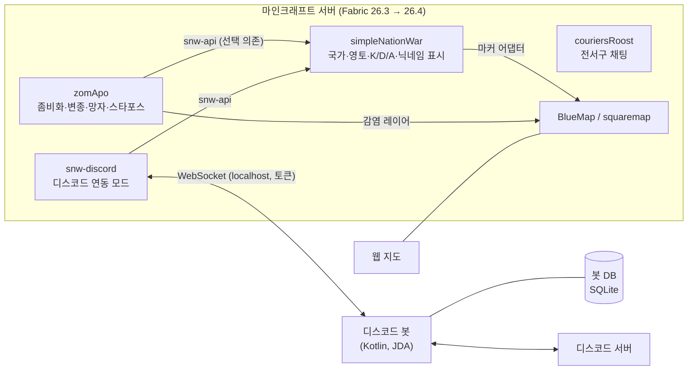

# 서버 마스터 플랜

좀비 아포칼립스 야생 + 3국 집단 생존 서버. 이 문서는 두 모드(zomApo, simpleNationWar)와 디스코드 봇을 아우르는 최상위 기획이다.

## 1. 전제

| 항목 | 값 |
|---|---|
| 전체 인원 | 10~15명 (친구 서버, 화이트리스트) |
| 활성 인구 | 3~4명 (하루 2시간 이상 접속) |
| 국가 | 3개 고정. 랜덤 또는 합의로 균등 배분 |
| 난이도 | 어려움(Hard) |
| 버전 | 26.3 에서 개발·테스트, 26.4 정식 출시 즉시 26.4 로 전환 |
| 개장 | 2027년 1월 (시즌 1, 약 10주) |
| 모드 | Fabric, Kotlin, 서버 사이드 전용 |
| 커뮤니티 | 디스코드. 팀 확정 후 국가별 채널 분리 |

## 2. 설계 원칙

1. **바닐라 클라이언트로 접속한다.** 직접 만드는 모드는 모두 `environment: "server"`. 리소스팩도 요구하지 않는다. 새 블록·엔티티 대신 바닐라 엔티티 + 데이터 부착, 바닐라 아이템 + 컴포넌트, 상자 GUI·다이얼로그·액션바로 표현한다.
2. **한 명만 접속해도 재미있어야 한다.** 시뮬레이션상 플레이 시간의 59~74% 는 같은 국가 사람이 아무도 없을 때다([simulation.md](simulation.md)). 국가 내부 협동만 믿으면 '집단'을 체감하기 어렵다. 그래서 비동기 협동(국고, 국가 프로젝트, 전서구 편지)과 국가 간 상호작용(교역, 동맹, 공동 이벤트)을 함께 설계한다.
3. **국가는 협력 단위, 전쟁은 양념.** 국가 모드는 집단 형성이 목적이다. 오프라인 약탈은 불가능하고, 충돌은 예약된 시간의 거점전과 야생 조우로만 일어난다.
4. **명령어는 적게.** 일반 플레이어가 외울 명령어는 `/n`(국가 GUI)과 `/info` 두 개. 나머지는 블록 상호작용과 GUI 로 한다.
5. **기록은 남긴다.** K/D/A, 좀비 처치 수, 좀비 스코어, 감염 레벨 이력을 모두 저장한다. 당장 쓸 곳이 없어도 시즌 결산과 다음 시즌 밸런스에 쓴다.

## 3. 결정 요약

질문별 상세 근거는 [decisions.md](decisions.md).

| 주제 | 결정 | 한 줄 이유 |
|---|---|---|
| 주민 거래소(주민작) | **제한적 허용**: 국가당 주민 상한, 영토 안 주민 번식 불가(구출로만 확보) | 아포칼립스에서 주민은 귀한 생존자. 거래 자체는 막지 않는다 |
| 초기 정착지 | **반랜덤 공정 배치**: 정삼각형 꼭짓점 3곳을 미리 고르고 국가에 무작위 배정, 첫 주 수도 이전 1회 | 완전 랜덤은 지형 격차, 자유 선택은 초반 쏠림 |
| 서버맵 공개 | **지형·영토 공개, 실시간 위치·지하 비공개**, 링크는 디스코드 멤버에게만 | 정보는 외교의 재료지만 위치 추적은 사냥 도구 |
| 목표 | **치료제 연구 레이스**(국가) + 감염 억제(서버 공동) + 칭호·통계(개인) | 국가 간 경쟁과 협력이 함께 생기는 구조 |
| 인벤세이브 | **끔 + 망자 좀비**: 소지품을 든 좀비가 사망 지점에 남는다 | 손실 긴장감은 살리고 복구 수단은 남긴다 |
| InfraCraft | **시즌 1 미채택** | 클라이언트 필수, Create Fly 의존, 26.2 전용 |
| couriersRoost | **채택**(26.4 포팅 후) | 서버 사이드 전용, '통신 두절' 테마와 맞음 |
| biomesmod | **미채택** | 새 블록 84종(클라이언트 필수), TerraBlender 필요, 26.3 미지원 |
| 월드젠 | **canvasworldgen 으로 균형 맵 제작**(1순위), 대안은 바닐라 시드 탐색 | 바닐라 블록만 쓰는 데이터팩이라 서버 사이드로 충분 |
| 가방 모드 | **미채택**, 바닐라 번들·셜커 상자로 대체 | 인벤토리 압박은 생존 긴장의 일부, 의존성 위험 |
| Enchanting Infuser | **미채택** | 클라이언트·서버 양쪽 설치 필수, 26.3 빌드 미확인 |
| 커스텀 인첸트 | **채택**: 데이터팩 6종, 효과는 모드가 처리 | 바닐라 클라이언트에서 이름·툴팁이 그대로 보인다 |
| 스타포스 | **채택(순한 맛)**: 최대 15성, 파괴 없음, 보너스는 좀비 대상 100% · 플레이어 대상 30% | 장기 목표와 자원 소모처. PvP 격차는 억제 |
| 좀비화 진척도 | **하이브리드**: 전역 시간 램프 + 국가 열기(최근 7일, 활동 국민 1인당, 처치 수 로그) − 정화 + 개인 숙련도 보정 | 누적 방식은 단조 증가·국가 격차·인원 의존 문제가 시뮬레이션에서 확인됨 |
| 국가 편성 | **상호평가 기반 균형 편성안 → 합의 → 확정** | 완전 랜덤이면 15명/활성 4명에서 45% 확률로 핵심 유저 0명인 국가가 생긴다 |

## 4. 전체 구성

| 구성 요소 | 저장소 / 브랜치 | 설명 |
|---|---|---|
| zomApo | `menonng/zomApo` | 좀비 시스템 전부 |
| simpleNationWar | `menonng/simpleNationWar` 기본 브랜치 | 국가 시스템, 지도 연동, 스탯 표시, 닉네임 표시 |
| snw-discord | `menonng/simpleNationWar` 의 `discord-mod` 브랜치 (예정) | 디스코드 봇과 통신하는 서버 모드 |
| 디스코드 봇 | `menonng/simpleNationWar` 의 `discord-bot` 브랜치 (예정) | 독립 실행 프로세스. 가입·닉네임·상호평가·팀 편성·알림 |

디스코드 쪽 설계는 simpleNationWar 의 [docs/discord](https://github.com/menonng/simpleNationWar/tree/HEAD/docs/discord) 에 있다.

## 5. 플레이 루프

| 시간 단위 | 하는 일 |
|---|---|
| 한 세션(1~3시간) | 파밍·건축 → 밤에 좀비 대응 → 좀비 스코어 획득 → 국고에 납품 / 강화 시도 |
| 하루 | 06:00 감염 레벨 재계산, 액션바·디스코드로 변화 알림 |
| 주 | 수·금 22:00 보급 투하(국가 간 조우 지점), 토 21:00 블러드문 호드, 주말 거점전 시간 |
| 시즌(10주) | 1주 정착 → 2~4주 확장·첫 블러드문 → 5~7주 거점 경쟁·치료제 연구 → 8주 클라이맥스(2월 말) → 9~10주 엔딩·결산 |

3월 개학·개강 이후 활동이 줄어든다는 가정(시뮬레이션상 핵심 유저 3.8명 → 2.1명)에 따라 클라이맥스를 2월 마지막 주에 둔다.

## 6. 문서 목록

- [decisions.md](decisions.md): 결정 사항 상세
- [modlist.md](modlist.md): 모드·데이터팩 목록과 추가 추천
- [version-policy.md](version-policy.md): 버전 정책
- [simulation.md](simulation.md): 시뮬레이션
- [roadmap.md](roadmap.md): 일정
- [../reference/monun.md](../reference/monun.md): monun 저장소 16개 분석
